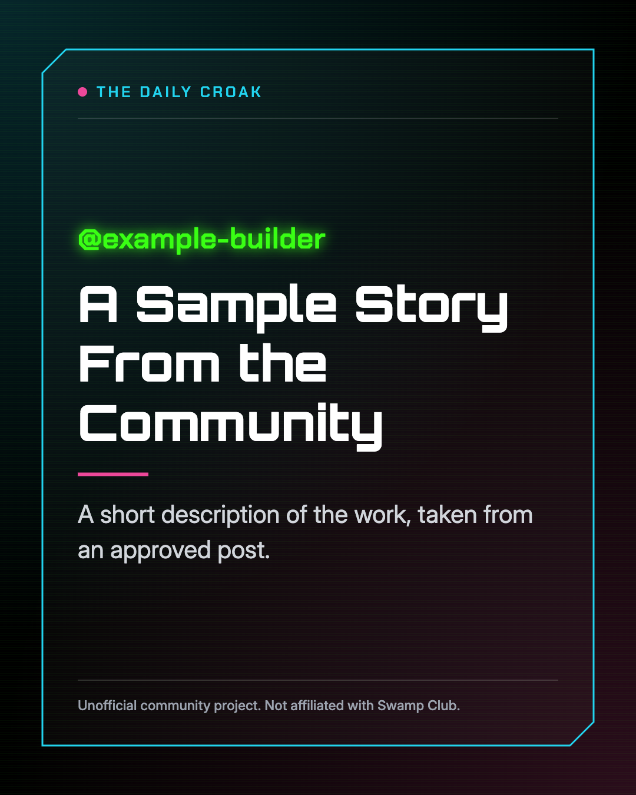

# The Daily Croak

The Daily Croak is a small content desk built on [Swamp](https://swamp-club.com). It finds recent posts from the Swamp community, drafts a short post about each builder, and waits for a person to approve every one. It never publishes anything by itself.

This is an unofficial community project. It is not affiliated with or endorsed by Swamp Club.



## Why it exists

Community writing is some of the best marketing material a developer tool can have, but nobody can read everything by hand. This project shows how a daily content routine can run as a Swamp workflow, with code doing the searching and AI used only for the writing.

## How it works

1. **Find** reads the public Swamp Club Feed and the newest extensions in the registry.
2. **Pick** takes the newest post from each builder, up to three, and uses new extensions to fill any spare places.
3. **Draft** asks Claude Haiku to write one short post from the full source text, then checks its spelling of Swamp and its numbers and links.
4. **Approve** is done by a person, one builder at a time, after reading the draft beside its source.
5. **Image** turns an approved post into 4:5 and 9:16 images for social media and Discord.

The studio is a local web page that runs all five steps. Images of unapproved posts carry a NOT APPROVED stamp.

## What you need

- [Swamp](https://swamp-club.com), installed and signed in
- [Node.js](https://nodejs.org) 18 or later
- An [Anthropic API key](https://console.anthropic.com)

Each run makes up to three small paid Claude Haiku calls. Finding, picking, approving and making images cost nothing.

## Set it up

Clone the repository, then run these commands from its folder:

```bash
mkdir -p "models/@thedarkpriestess/daily-croak"
cp examples/scout.yaml "models/@thedarkpriestess/daily-croak/scout.yaml"
swamp vault create local_encryption default
swamp vault put default ANTHROPIC_API_KEY
```

Swamp prompts for the key with hidden input, and it stays encrypted on your machine. Add any names you want to leave out to the skip list in `scout.yaml`, or in the studio later.

## Use it

Start the studio:

```bash
node studio/server.js
```

Open <http://localhost:4322>, press **Find and draft**, then review each draft. The studio only accepts requests from its own page and only runs on your machine.

You can also run the workflow without the studio. Without `live=true` it builds the prompts and makes no paid calls.

```bash
swamp workflow run daily-croak --input live=true
```

## What the checks do and do not catch

The Draft step checks the spelling of Swamp, and it flags numbers and links that are not in the source. It cannot confirm that a statement is true, so a person must read every draft against its source before approving it.

## Feature people with care

Approving a draft requires you to confirm that the builder agreed to be featured, so please ask them first. Drafts, approved posts and images are ignored by git, so they stay on your machine unless you choose to share them.

## Known limits

- A new run replaces any drafts that have not been decided.
- The project does not yet remember who has been featured, so a builder can appear again.
- It does not post to any platform or measure results.

## Run the tests

Swamp includes its own copy of Deno:

```bash
~/.swamp/deno/deno test --no-prompt extensions/behaviors/
```

## Credits and trademarks

Swamp and Swamp Club are trademarks of Elder Swamp Club, Inc., and they are named here only to describe what this project works with. The images use colors and fonts in a similar style, and they do not use Swamp Club's logos.

The studio includes [Orbitron](https://fonts.google.com/specimen/Orbitron), [Chakra Petch](https://fonts.google.com/specimen/Chakra+Petch) and [Inter](https://fonts.google.com/specimen/Inter), which are licensed under the SIL Open Font License. Their licenses are in `studio/fonts`.

## License

The code is available under the [MIT License](LICENSE).
